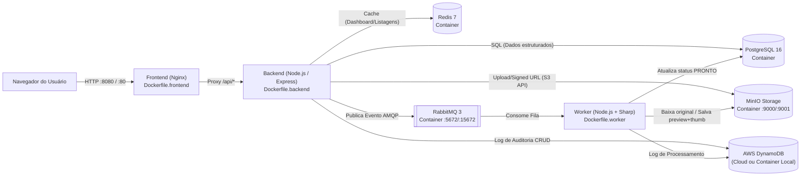

# MedCloud — Exames e Laudos Médicos (Trabalho Prático 2: Docker, Docker Compose & Kubernetes)

Aplicação web clínica para gestão de **pacientes**, **médicos**, **exames médicos com upload de imagens**, **processamento assíncrono (redimensionamento/otimização WebP)** e **auditoria NoSQL**, implantada integralmente com **Docker**, **Docker Compose** e manifestos **Kubernetes**.

---

## 1. Arquitetura do Sistema (Trabalho 2)



### Mapeamento dos Requisitos do Trabalho 2

| Requisito | Tecnologia Utilizada | Arquivo / Serviço |
| :--- | :--- | :--- |
| **Banco de Dados Relacional** | **PostgreSQL 16** (`postgres:16-alpine`) | Serviço `postgres` no `docker-compose.yml` |
| **Armazenamento de Arquivos** | **MinIO** (`cgr.dev/chainguard/minio`) — API compatível com S3 | Serviço `minio` no `docker-compose.yml` + `src/aws.js` |
| **Fila de Mensagens** | **RabbitMQ** (`rabbitmq:3-management-alpine`) | Serviço `rabbitmq` no `docker-compose.yml` + `amqplib` |
| **Banco de Dados NoSQL** | **AWS DynamoDB** (suporta AWS Cloud e `amazon/dynamodb-local`) | Tabela `medcloud-audit` em `src/aws.js` |
| **Imagem do Backend** | Node.js 20 Alpine + Express | `Dockerfile.backend` |
| **Imagem do Worker** | Node.js 20 Alpine + Sharp + AMQP | `Dockerfile.worker` |
| **Imagem do Frontend** | Nginx 1.27 Alpine + Proxy Reverso `/api/` | `Dockerfile.frontend` + `nginx.conf` |
| **Orquestração** | Docker Compose com rede `medcloud-net` e `healthcheck` | `docker-compose.yml` |
| **Extra: Kubernetes (+1,0 pt)** | `Deployment`, `Service` (`ClusterIP` e `NodePort`), `Secret`, `ConfigMap` | Pasta `k8s/` |

---

## 2. Pré-requisitos

- **Docker** (v20.10+)
- **Docker Compose** (v2+)

---

## 3. Como Baixar, Construir as Imagens e Iniciar os Serviços

### Passo 1: Clonar o repositório
```bash
git clone -b trabalho-2-docker https://github.com/Picxs/medcloud-aws.git
cd medcloud-aws
```

### Passo 2: Configurar variáveis de ambiente
O projeto já inclui o arquivo `.env` configurado para execução imediata (ou copie a partir do exemplo):
```bash
cp .env.example .env
```

> **Sobre o DynamoDB (AWS Cloud vs. Container Local):**
> - **Modo Padrão (Local / Sem custo AWS):** A variável `DYNAMO_ENDPOINT=http://dynamodb:8000` no `.env` conecta automaticamente ao container oficial da AWS `amazon/dynamodb-local`. A tabela `medcloud-audit` é criada automaticamente na inicialização.
> - **Modo AWS Cloud (Nuvem da AWS):** Para gravar diretamente na sua conta AWS, basta comentar ou deixar vazia a variável `DYNAMO_ENDPOINT=` no `.env` e inserir suas credenciais da AWS em `.aws/credentials` (ou definir `AWS_ACCESS_KEY_ID`, `AWS_SECRET_ACCESS_KEY` e `AWS_SESSION_TOKEN` no `.env`).

### Passo 3: Construir as imagens e subir todos os containers com um único comando
```bash
docker compose up -d --build
```

### Passo 4: Verificar se os containers estão em execução
```bash
docker compose ps
```

Todos os 8 containers estarão ativos na rede `medcloud-net`:
- `medcloud-frontend` (Portas `80` e `8080`)
- `medcloud-backend` (Porta `3000`)
- `medcloud-worker` (Background Consumer)
- `medcloud-postgres` (Porta `5432`)
- `medcloud-minio` (Portas `9000` API e `9001` Console Web)
- `medcloud-rabbitmq` (Portas `5672` AMQP e `15672` Painel Web)
- `medcloud-redis` (Porta `6379`)
- `medcloud-dynamodb` (Porta `8000`)

---

## 4. Endereços e Credenciais de Acesso

| Serviço | URL de Acesso | Usuário | Senha |
| :--- | :--- | :--- | :--- |
| **Aplicação Web (Frontend Nginx)** | http://localhost:8080 (ou http://localhost) | — | — |
| **API Backend (Healthcheck)** | http://localhost:3000/api/health | — | — |
| **MinIO Console (Arquivos/Buckets)** | http://localhost:9001 | `minioadmin` | `minioadmin123` |
| **RabbitMQ Management (Filas)** | http://localhost:15672 | `medadmin` | `medcloud123` |
| **PostgreSQL** | `localhost:5432` (Banco: `medcloud`) | `medadmin` | `medcloud123` |

---

## 5. Roteiro de Testes e Evidências de Funcionamento

1. **Acessar o Frontend (`http://localhost:8080`)**:
   - Verifique no canto inferior esquerdo o indicador `container: <id> · RabbitMQ: connected` e no topo o badge `Redis: MISS` / `Redis: HIT`.
2. **Cadastrar Paciente e Médico (Persistência no PostgreSQL)**:
   - Acesse a aba **Pacientes** e cadastre um paciente (ex.: *Maria Silva*, CPF `123.456.789-00`).
   - Acesse a aba **Médicos** e cadastre um médico (ex.: *Dr. Carlos Mendes*, CRM `12345-CE`, *Radiologia*).
3. **Enviar um Exame com Imagem (MinIO + RabbitMQ + Worker)**:
   - Acesse a aba **Exames**, selecione o paciente, o médico, o tipo de exame e envie qualquer imagem (`.jpg`, `.png`, `.webp`).
   - O backend salvará a imagem original no bucket `medcloud-exames` do **MinIO** e publicará o evento `EXAME_UPLOADED` na fila `medcloud.exames.processamento` do **RabbitMQ**.
   - O container `medcloud-worker` consumirá a mensagem do RabbitMQ, gerará as versões otimizadas (`-preview.webp` e `-thumb.webp`) com **Sharp**, salvará no **MinIO** e atualizará o status do exame no **PostgreSQL** de `PROCESSANDO` para `PRONTO`.
4. **Conferir Arquivos no Painel do MinIO (`http://localhost:9001`)**:
   - Faça login com `minioadmin` / `minioadmin123`.
   - Abra o **Object Browser** -> bucket `medcloud-exames` -> veja os 3 arquivos gerados para o exame: imagem original, `-preview.webp` e `-thumb.webp`.
5. **Conferir a Fila no Painel do RabbitMQ (`http://localhost:15672`)**:
   - Faça login com `medadmin` / `medcloud123`.
   - Na aba **Queues and Streams**, clique na fila `medcloud.exames.processamento` e veja as métricas de mensagens publicadas e consumidas pelo worker.
6. **Conferir Logs de Auditoria no DynamoDB**:
   - Na aplicação web, clique na aba **Auditoria**.
   - Veja todos os registros `CREATE`, `READ`, `UPDATE`, `DELETE` e `PROCESS` (gerado pelo Worker com a taxa de redução de tamanho da imagem) vindos diretamente da tabela `medcloud-audit` do **DynamoDB**.

---

## 6. Pontuação Extra: Implantação no Kubernetes (K8s)

Os manifestos na pasta `k8s/` configuram todos os serviços utilizando:
- **`Secret` (`medcloud-secrets`)** e **`ConfigMap` (`medcloud-config`)** para gerenciamento seguro de credenciais e variáveis de ambiente (`k8s/01-secrets-configmap.yaml`).
- **`Deployment`** e **`Service` (`ClusterIP` e `NodePort`)** para banco relacional, MinIO, RabbitMQ, Redis, DynamoDB, Backend, Worker e Frontend (`k8s/02-infra.yaml` e `k8s/03-app.yaml`).

### Comandos para executar no Kubernetes (Minikube / Kind / Docker Desktop K8s)
```bash
# 1. Construir as imagens locais
docker compose build

# (Se estiver usando Minikube, carregue as imagens para dentro do cluster)
# minikube image load medcloud-backend:latest medcloud-worker:latest medcloud-frontend:latest

# 2. Aplicar Secrets, ConfigMap, Deployments e Services
kubectl apply -f k8s/

# 3. Verificar os Pods e Services
kubectl get pods
kubectl get svc
```
O Frontend ficará acessível via `NodePort` na porta **`30080`** (`http://localhost:30080`) e o MinIO na porta **`30900`/`30901`**.

---

## 7. Comandos Úteis

```bash
# Acompanhar os logs do backend e do worker em tempo real
docker compose logs -f backend worker

# Parar os containers mantendo os dados nos volumes
docker compose down

# Parar os containers e apagar os volumes de dados (reset completo)
docker compose down -v
```

